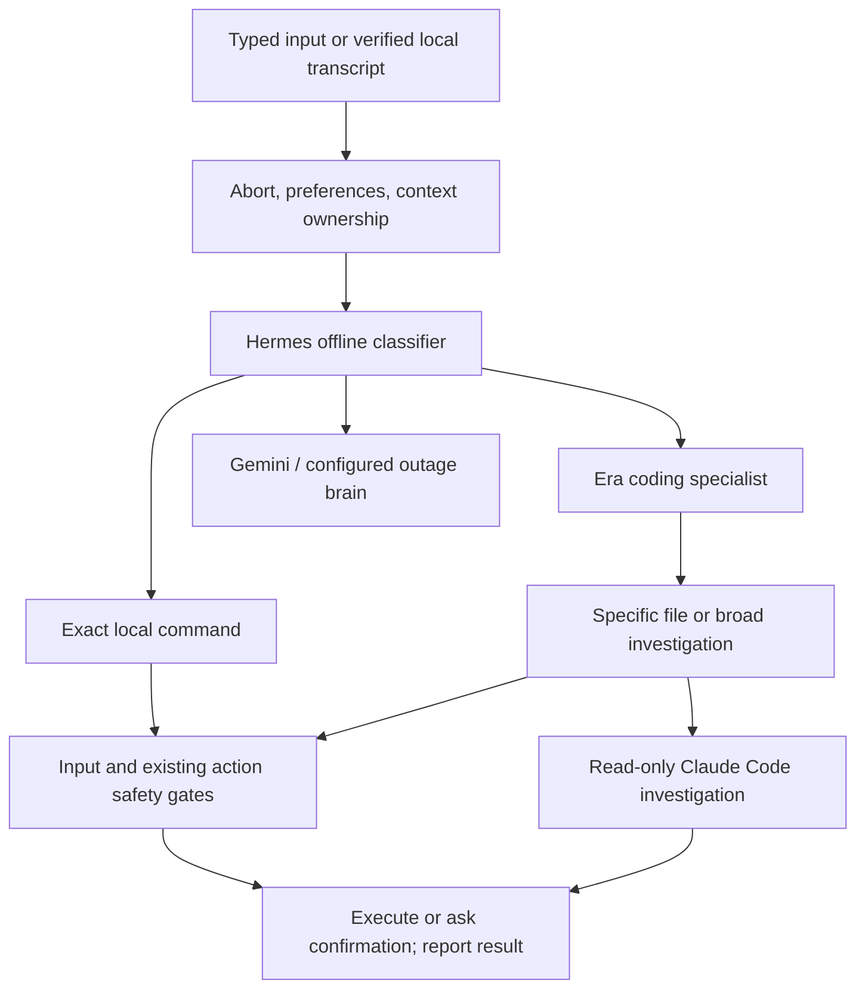

# Era One Autopilot: Hermes / Hermos decision architecture

This update implements an offline routing gate in `core/autopilot.py` and an
executor in `app/era_live/autopilot.py`. It preserves the stability repairs from
the previous ZIP. Routing selects the execution mechanism; it does not grant
permission or prove that an operation succeeded.

## Decision criteria

| Lane | Criteria | Execution | Examples |
| --- | --- | --- | --- |
| No-LLM local command | Entire utterance matches an allowlisted grammar; every parameter is explicit and valid; a single action is requested | Existing gated audio, window, or file tool | `volume up`, `set volume to 50`, `glasses volume down by 5`, `minimize window "Spotify"` |
| Local specialist | Engineering imperative plus an Era One project scope or a recognized repository Python path | Claude Code CLI | `audit Era One for crashes`, `refactor Era One architecture`, `fix Era One retries in app/era_live/audio.py` |
| Main LLM | Conversation, research, reasoning, uncertain target, mixed actions, pasted content, unsupported grammar | Existing Gemini Live flow, or configured outage brain | `why is the volume low?`, `volume up and explain why`, `compare these plans` |

The word “volume” alone is not sufficient evidence for an action. Similarly,
mentioning “Claude” or “code” does not start a coding job. The classifier can
abstain. It does not ask a paid model to decide whether a paid model is needed.

### Supported local commands

- System/glasses volume: numeric levels 0–100, up/down with an optional step,
  mute/unmute. Bare volume commands target the system. Explicit glasses/lunettes
  commands retain that device scope. Microphone mute keeps its existing handler.
- Windows: list, focus, minimize, maximize, restore, close. Quote a title with
  conjunctions, such as `focus "Research and Development"`.
- Files: `list files in "absolute path"`, `read file "absolute path"`,
  `file info "absolute path"`, `open file "absolute path"`,
  `delete file "absolute path"`, and
  `copy file "absolute source" to "absolute destination"` / `move file ...`.
  Paths must be quoted, absolute, and free of wildcards. Overwrite is not enabled
  by the transfer grammar. Relative, inferred, or fuzzy targets go to the normal
  assistant instead. Existing path protection and runnable-file rules remain.

The initial grammar supports English and a small explicit French volume grammar.
Unsupported phrasings abstain rather than guessing. Extend it with regression
examples before enabling more phrases. A future lightweight local classifier
can suggest a lane, but must never invent executable tool arguments: local
execution still requires a complete grammar and validated parameters.

## Execution flow



1. Abort/reboot, voice/model preferences, and contextual resume keep precedence.
   Standby and active approval/brand questions retain ownership of their input.
2. Hermes checks complete command grammars, then repository coding intent, then
   abstains to the main lane. These decisions do not make network requests.
3. The typed gate runs before pinned model dispatch and the cloud-session check.
   A disconnected Gemini session therefore does not disable local commands or
   Claude Code. The engine event loop must still be running.
4. Local actions enter `_execute_tool_result`, retaining risk classification,
   pending confirmations, protected paths, and result verification. A parsed
   command never directly calls a raw desktop function.
5. Local results and confirmation details go directly to the HUD/Telegram reply
   path. They do not ask Gemini to read the result aloud. This release uses HUD
   text for these acknowledgements; it does not add a second audio player.
6. Logs record the lane, grammar rule, elapsed execution time, and error type.
   Routing telemetry does not add full user text or credentials.

### Coding execution

A clear change to one explicitly named repository Python file routes to
`autonomous_development`. Claude generates a bounded candidate in a separate
workspace; existing Python is applied there through self_improve, tests and
diagnosis run, then the diff waits for final user approval in the HUD. Nothing
is written to live source while generation/verification runs. The safety
framework and fixed regression gates are excluded from candidate edits.

Explicit “add”/“implement” feature requests scoped to Era One also stage a
candidate. Broad audit/debugging and ambiguous improvement requests run a
contained read-only Claude investigation. Analysis-only wording never becomes
an apply. Use the staged tool for a concrete multi-file feature request.

Scene changes apply live; approved UI bundles reload the browser when requested;
approved standalone feature modules can reload in process. Existing engine
Python edits require restart. See `VISUAL_ENGINE_ARCHITECTURE.md` for the final
approval and recovery contracts.

Claude Code is a locally launched CLI using a configured Claude account/model.
Inference is generally remote and can consume subscription quota or incur
provider charges. “Local specialist” describes the execution tool, not free
offline inference. The default model comes from `era.deep` in `config/llm.yaml`;
`ERA_AUTOPILOT_CODING_MODEL` overrides the investigation model. The verified
generator retains the existing alias/account failover behavior.

The investigation runner restricts available tools, runs in plan mode, disables
MCP discovery, limits turns/budget, and bounds execution time. Its process is
killed on timeout/cancellation. These controls are not an OS sandbox. Claude
configuration, login, supported CLI flags, and project hooks must be validated
on the target PC. The official CLI distinguishes `--tools` (available tools)
from `--allowedTools` (permission prompting):
https://code.claude.com/docs/en/cli-reference

## Voice boundary

The existing local VAD/STT path classifies verified transcripts before its
Ollama/CodeCraft brain. Exact local commands therefore bypass that brain.
This path requires the existing speech models and speaker enrollment.

The ordinary Gemini Live microphone still sends audio directly to Gemini.
Its input transcript arrives after transmission and may arrive after a tool
call. Re-executing that transcript locally would risk double actions. This
release deliberately does not add such an intercept and cannot claim zero
Gemini usage for cloud voice commands. For a voice path that avoids Gemini,
use the existing local/cascade voice mode with its models configured.

A future always-on front end would require verified local STT/VAD to own all
microphone input, then send only main-lane text to Gemini and select playback
per turn. It must also preserve streaming barge-in, wake detection, enrollment,
and contextual confirmations. That audio migration is a separate hardware-
dependent project, not something silently simulated by this ZIP.

## Failure and misclassification behavior

| Condition | Behavior |
| --- | --- |
| Ambiguous, conditional, conversational, pasted, unsupported, or compound command | Abstain to main lane; execute no local action |
| Missing/invalid routing policy | Missing policy uses shipped defaults; malformed policy disables actions |
| Pending approval/brand question | Preserve its owner; no competing action |
| Local tool fails or exceeds 30 seconds | Show failure; never replay through an LLM because effects may already exist |
| Local mutation requires approval | Display tool/parameters or the existing resolved preview; `yes` replays stored arguments through the approval gate; `no` cancels |
| Protected target | Existing gate blocks it; no automatic alternate route |
| Claude investigation unavailable, fails, or times out | Visible failure, 60-second cooldown, Gemini analysis-only fallback if connected |
| Claude change generation fails | Existing pipeline reports failure/rollback; no silent Gemini code generation |
| Main provider also unavailable | Visible retry/setup guidance; no success claim |
| Coding lane busy | Reject extra coding work with a retry message; independent local-command lane remains available |
| Panic or shutdown | Refuse queued actions and cancel active investigation tasks |

One active task per lane prevents unbounded queues. Coding has a default cap of
10 initial requests per local calendar day per process. This count resets on
restart; the existing persisted spend ledger is the monetary backstop. A
confirmed continuation is not counted as a second initial request.

Timeout cancellation cannot undo OS work already running in a worker thread,
nor interrupt a verified self-edit safely midway through its transaction. These
actions are not automatically retried. The bounded investigation subprocess is
cancellable; the existing edit pipeline remains responsible for completion,
verification, and rollback.

## Configuration and inspection

Autopilot is enabled in `config/autopilot.json`. Disable the new lanes for the
current Windows terminal with `$env:ERA_AUTOPILOT = "0"`.

| Setting | Default | Purpose |
| --- | --- | --- |
| `ERA_AUTOPILOT` | enabled | Override the new lane policy |
| `ERA_AUTOPILOT_CODING_TIMEOUT_S` | 300, bounded 1–600 | Investigation deadline |
| `ERA_AUTOPILOT_CODING_MAX_PER_DAY` | 10, bounded 1–100 | Per-process coding request cap |
| `ERA_AUTOPILOT_CODING_MODEL` | registry `era.deep` | Investigation model override |
| `CLAUDE_CONFIG_DIR` | existing registry profile | Explicit profile for investigation |
| `HERMES_PROVIDER_ORDER` | `rules` | Existing CM classifier; models remain explicit opt-ins |

The CM extension still uses the existing brand-isolated dispatcher. Default
CM classification is now deterministic. Brandless clear production orders
retain the “which brand?” flow. Setting `HERMES_PROVIDER_ORDER=ollama,gemini`
explicitly restores model-assisted CM classification; its local timeout is
bounded to 1–10 seconds, default 2. These optional CM providers are not needed
for the new local/coding front gate.

Inspect a decision without executing anything:

```powershell
.\.venv\Scripts\python.exe tools\era_autopilot.py "set volume to 50"
.\.venv\Scripts\python.exe tools\era_autopilot.py "audit Era One for crashes"
.\.venv\Scripts\python.exe -m pytest tools\test_autopilot.py -q
```

## Expected benefits and evidence

Exact local commands make zero routing/model requests, remove classifier/model
latency, and work through network/provider outages. They still incur actual
device/file execution time and retain confirmation where required. Claude
coding runs independently of the voice loop, while uncertain language retains
the main model's reasoning capabilities. Bounded work, visible errors, and no
automatic replay improve failure containment.

There is no invented latency or savings percentage. The tests prove routing and
failure contracts with fake transports/devices; the diagnostic provides a way
to measure decisions. Windows hardware, real Claude authentication, cloud voice,
and sustained live operation still require target-PC acceptance testing. See
`AUTOPILOT_VALIDATION.md` and the earlier stability audit for the tested limits.
