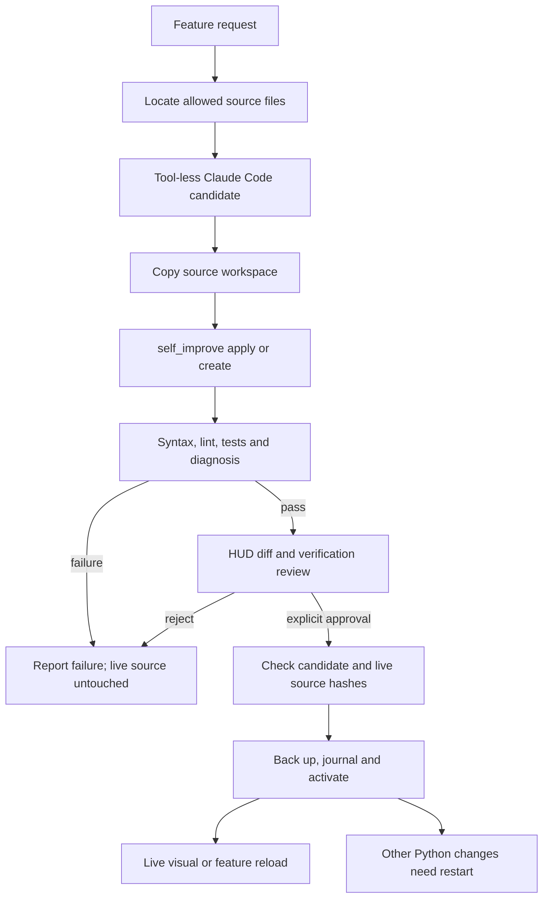

Current HUD layout: the empty Live Workspace toolbar is removed. Development is a header button immediately left of the clock; its controls are in a dedicated drawer. Development progress is shown in left Live Activity. See AUTONOMY_HUD_RELEASE.md for discovery, bounded repair, and memory changes.

# Live HUD and autonomous development

This update retains the prior stability and Autopilot repairs. It implements a
live declarative visual workspace, authenticated scheduled-task controls, and a
staged feature-development workflow with final user approval.

## Running HUD

The production bundle is rebuilt and included at `ui/dist/index.html`. The engine
serves it over its existing authenticated localhost HTTP/WebSocket server. No
Node process is needed to use the included HUD.

`visual_engine` accepts a JSON command. Supported widgets: text, metric, liquid
progress, chart, button and field. Layout controls: theme, density, columns,
accent colour and left/right panel visibility. Scene updates persist atomically
at `runtime/visual_scene.json`, increment a revision and emit `visual.changed`.
The browser subscribes to these events, with three-second polling as recovery.

Canvas drawing uses requestAnimationFrame, caps drawing at approximately 30 FPS,
skips drawing while hidden, respects reduced-motion settings and releases the
frame callback on unmount. React renders the controls; no generated HTML, CSS
code, JavaScript or shell command is executed from a scene. Charts accept at most
128 samples, a scene at most 24 widgets, and text/numbers/layout values are
validated. Fields save their new values with revision checks. Buttons open only
known drawers. CPU/RAM data comes from existing telemetry; development progress
comes from recorded workflow phases, not an invented duration estimate.

Examples spoken or typed into Era:

- `hide the right panel`
- `set HUD accent #12aabb`
- `add liquid progress for background tasks`

These exact grammars use the no-LLM Autopilot lane. More open-ended visual
requests go to the model, which translates them into `visual_engine` calls. A
source-level UI feature instead uses `autonomous_development`.

Example visual tool arguments:

```json
{"command":"{\"action\":\"upsert\",\"widget\":{\"id\":\"work\",\"kind\":\"progress\",\"label\":\"Development\",\"binding\":\"development\"}}"}
```

REST (all require the existing session token, allowed Host and Origin):

| Endpoint | Operation |
| --- | --- |
| GET /api/visual | Scene, revision and frontend bundle fingerprint |
| POST /api/visual | Validated scene mutation; optional revision comparison |
| GET /api/schedule | Task previews and revision fingerprints |
| POST /api/schedule/action | Create reminder; pause, resume, reschedule, run now, cancel, approve or skip |
| GET /api/development | Latest jobs with diffs, checks, state and approval fingerprint |
| POST /api/development | Propose a candidate; explicitly approve/activate or reject it |

Task approvals bind the stored action, parameters, condition, schedule and
pending run. Changed previews are refused. Running a risky task now retains the
scheduler's risk gate; it cannot turn a Run now click into an approval. The HUD
shows the full action preview, masks credential-shaped values and refuses HUD
approval when the preview exceeds its display limit. Cancel and approve require
explicit confirmation. Reminder creation is deterministic and invokes the real
scheduler without an LLM.

## Development workflow



`autonomous_development(action='propose', request=..., reload=true)` finds source
files when none are specified. It asks the existing Claude CLI adapter for a
bounded JSON plan: at most six source files, 200 KB combined, and focused tests.
It has no generator tools and no silent Gemini-generation fallback. `code_helper`
is never used on Era's own source. Budget checks and one active generation job
limit concurrency. An explicitly protected target is refused rather than silently
retargeted. The safety framework and fixed regression gates cannot be generated
away. Claude failure is a visible failed job; analysis can continue separately.

Existing Python files run through `self_improve(action='apply')` in the copied
workspace. New Python files use its staging-only `create` operation. UI source
is written only in staging. The worker runs syntax/lint, generated tests PLUS
fixed stability/routing/approval/development regressions, the reloadable feature
contract, and real `self_diagnosis(deep=false)`. Visual source also requires
`npm ci --ignore-scripts`, TypeScript checking and a production build. Safe Ruff
normalization is followed by a new lint check, and approval hashes bind the
normalized, tested bytes. Failures never activate the candidate.

Diagnosis is shown separately: missing keys/devices in a credential-free copied
workspace can produce NOT READY/BROKEN even when code tests pass. This is not
hidden or relabelled as full system readiness. The user reviews it before approval.

The model's development tool exposes only propose/status/reject. Final approval
belongs to the authenticated HUD. A checkbox acknowledges review, and the
activation request carries the exact approval fingerprint. Activation requires
passing checks, unchanged candidate bytes and unchanged live base files. A
stale preview must be regenerated and verified. Deployed files have backups;
a persisted activation journal supports rollback after interruption and preserves
external edits by requiring manual recovery instead of overwriting them.

## Reload contract

| Change | Effect after final approval |
| --- | --- |
| Declarative scene | Applies to the running HUD immediately after its event |
| UI source/bundle, reload=true | Reloads the browser view; Python engine continues |
| features/name.py only | Validates and swaps feature registry in the running process |
| Existing engine Python or mixed engine/feature edits | Commits verified source, reports restart required, and delays new feature imports until a new engine session |

An approved reloadable module supplies `FEATURE = {"id": "...", "description":
"..."}` and `run(arguments) -> JSON-serializable result`, sync or async. Modules
are compiled from their current approved bytes, avoiding stale pyc caches. The
`run_feature` tool invokes registered modules through the normal explicit
confirmation gate. On restart, only recorded approved modules with matching
hashes are restored. Edited modules cannot inherit an old approval.

## Boundaries

The copied workspace and worker process isolate source changes, not arbitrary
operating-system activity. Generated tests/imports execute Python on the host;
this is not an OS sandbox. Do not give untrusted third-party code the same trust
as your own reviewed feature requests. A container or restricted worker account
would be needed for adversarial-code isolation.

Feature execution has a 30-second wait timeout. Python threads cannot be forcibly
stopped by that timeout; synchronous code may continue, so failed/time-out actions
must not be automatically replayed. General Python module replacement without a
restart is deliberately not claimed. A browser reload can reset transient HUD
view state, while persisted scene/tasks/jobs remain on the backend.

Read `VISUAL_DEVELOPMENT_VALIDATION.md` for measured results and
`VOICE_24_7_PROPOSAL.md` for the proposed next voice-continuity architecture.
