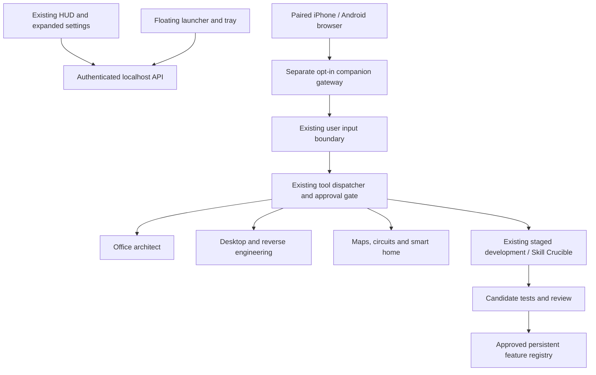

# Era One capability expansion

Reference inspected: https://github.com/titechprabhasolutions/Brahma-Ai-Evo at
`c8d9c0f8f1b14b67baf4c258a15be631793a7381` (20 October 2026).
Its source-available license restricts redistribution. The reference checkout
stays outside Era; new implementations use Era's own interfaces and dependencies.
No upstream source, assets, prompts, or branding are vendored.

## Decision and scope

The owner authorized implementation and dependency installation. Extend the current
Python backend and React HUD with independently testable capabilities. A wholesale
PyQt UI transplant would replace working voice and HUD behavior; a second assistant
process would duplicate credentials, memory, dispatch and lifecycle. Neither fits.
New tools use the normal dispatcher, confirmations and result telemetry.
Credential changes use the existing Windows DPAPI store. No paid fallback is added.

## Coverage inventory and source findings

| Reference feature | Era integration / acceptance |
| --- | --- |
| Skill Forge / Crucible / dynamic registry | Reuse development + feature_engine; explicit skill-generation request, test requirements, catalog and approval in HUD. Child process tests are not an OS sandbox. |
| Auto-heal | Preserve existing bounded self_heal, probation, rollback and owner policy. |
| Windows orchestration | Preserve computer_settings, window_control, monitor_move and system_performance; add bounded UI Automation inspection, process suspend/resume and clipboard processing. |
| Office | Structured DOCX, multi-sheet XLSX with formulas/charts, PPTX with notes, PDF create/merge/extract; verify persisted outputs, no silent overwrites. |
| Connect | Independent opt-in gateway; expiring one-use pairing, revocable device credentials, Safari/Android text companion, replies and explicit sharing. Do not expose localhost HUD or its token to LAN. |
| Phone calls / SMS / background GPS | Reference README says Android; this checkout's call proxy controls desktop calls and audio. No native iOS app is supplied. Browser companion must describe iOS limits accurately; existing Telegram call lane remains available. |
| Reverse engineering | Static source/HTML/PE inspection plus REA JavaScript/Electron, managed artifacts, WABT and explicit Ghidra decompilation. Retain evidence; never launch inspected programs. Reconstruction uses staged development. |
| Vision | Preserve screen_process and provider failover; expose provider configuration, capability readiness and explicit screen/camera commands. |
| Floating launcher | Draggable always-on-top icon, tray actions, persisted visibility, existing HUD launch and restart callbacks. |
| Detailed settings | Schema-driven service credentials with masked configured status, validated preferences, connection tests and dependency readiness. |
| Hardware circuits | DHT11 templates for Arduino Uno and ESP32 with pin connections, sample firmware and electrical caveats. Other components need datasheet-led development; no universal circuit editor or hardware testing. |
| Maps / radar | Explicit location queries and map links, route geometry and live public data with source/time/error reporting. |
| Smart home | Configured Home Assistant integration (including its Tuya integration); state-changing calls remain gated. |
| FFT / glow / execution cards | Existing HUD already provides amplitude/bands, state glow, tool progress, durations and result surfaces; reuse them. |
| Memory / identity / scheduling / briefing / browser / search | Existing Era systems remain authoritative. |
| Spotify | Excluded from this integration; preserve Era's existing desktop playback. |
| Social accounts / Discord / fitness / game tools | Existing community/browser/Telegram systems retained. No new Discord, fitness or game adapters; these remain outside implemented parity and require accounts/hardware. |

## Verification and failure behavior

Use isolated temp storage and fake providers for automated tests, then inspect real
generated Office files, compile/build the HUD and run protected regression suites.
Authentication, revocation, malformed parameters, path traversal, atomic writes,
no-overwrite behavior and truthful error results are acceptance boundaries.
Optional dependencies import lazily; missing configuration disables only its feature.
New services must not occupy the voice loop. Physical iPhone pairing, hardware,
Office application rendering and sustained live speech require separate evidence.

Progress and exact verification results are recorded in handoff.md and TODO.md.

## Verified implementation checkpoint — 22 October 2026

Full gate: **8,215 passed, 4 skipped**; format, lint, manifest and doctor passed.
TypeScript check and production UI build passed. Isolated real-browser checks
covered invalid settings, mobile pairing/chat/replies/revocation, and a real Qt
floating icon shown/hidden on Windows. Real REA JavaScript and WABT evidence was
produced. Ghidra decompiled the Python executable's entry procedure using an
explicit provider selection; the Era wrapper now makes that selection itself.
The final wrapper decompilation also passed, retaining its evidence in
`runtime/deliverables/rea-evidence-f3cc32d6bb0a.json`. The live launcher required
a lightweight polling endpoint; 46 affected HUD/no-window tests passed after
that fix, and the icon was visually verified in the restarted live application.
No physical phone, electrical, Home Assistant or Office layout acceptance is claimed.

See [the usage guide](ERA_WORKBENCH_GUIDE.md) for controls, examples and limits.
