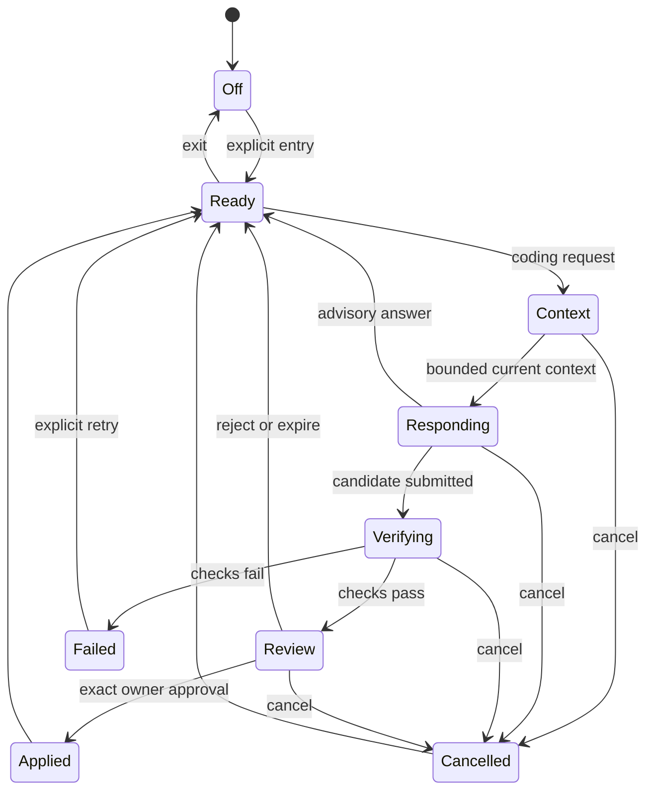

# CodeMode implementation design for review

Date: 2026-10-15. Status: approved by the user's “proceed” instruction; Phase 9
implementation and current acceptance evidence are in PHASE9_PROGRESS.md.
This replaces the early `CODEMODE_BRAINSTORM.md` as the Phase 8 review proposal.
The approved Master Plan requires a separately reviewed design before implementation.

## Experience and ownership

“Enter CodeMode” explicitly opens a coding session. Era acknowledges entry and
shows the mode and current phase in the existing conversation/Development surfaces.
Ordinary coding questions may suggest entry but never switch modes silently.
“Exit CodeMode” stops current generation and returns to ordinary conversation;
an existing verified proposal remains reviewable, with no automatic activation.
“Cancel this coding task” ends that work, discards late model output, stops speech,
and invalidates any unapproved proposal from that work. An explicit rejection stays
rejected. Merely interrupting speech pauses the mouth; it does not apply or cancel
a candidate unless the user asks. A correction creates a new turn revision.

Use `InputEnvelope` for channel/source identity, `ModelReplyOwnership` for the sole
reply owner, and the existing task registry for cancellation/deduplication.
Each event carries session ID, work ID, turn revision and sequence. Only the current
owner/revision can publish text, audio, progress or a proposal. Era remains the sole
speaking agent; Claude text is attributed in the transcript, voiced through the
existing SpeechOut and playback-aligned captions. The normal live-model path cannot
speak over a CodeMode-owned reply. Wake/standby and microphone controls stay usable.

## ADR: use a dedicated Claude Code CLI subscription session

Recommended: extend the existing CLI integration with an explicit subscription-only
CodeMode policy and an owned session handle. The installed CLI reports 2.1.289;
local help lists session IDs, resume, stream JSON, tool restrictions and profile
configuration. This establishes local flag availability, not successful authentication
or permission to bill an account. Official documentation describes Pro/Max CLI login
and API-key precedence: [Claude authentication](https://code.claude.com/docs/en/authentication).

CodeMode uses the user's selected signed-in profile, pinned for the session. Strip
gateway/API credential overrides from the child environment. Never read or copy login
tokens into prompts/logs. Do not auto-switch account, API billing, provider or remote
gateway. The ordinary adapter's current gateway-first/failover behavior is unsuitable
for this mode unless explicitly bypassed. Login/usage limits surface in the HUD;
the user signs in or chooses a new session/profile deliberately.

Alternative: an Agent SDK could simplify process/session events, but requires its
own documented authentication/terms compatibility check and explicit selection;
do not assume a CLI subscription credential is a general SDK/API credential.
Desktop automation is fragile and provides weaker event/cancellation evidence.
Choose the CLI path first. [Programmatic CLI](https://code.claude.com/docs/en/headless)
and [CLI reference](https://code.claude.com/docs/en/cli-reference) document the
supported output/session interface; validate exact behavior with the installed
version before depending on it.

Run advisory Claude with tools unavailable (`--tools ""` plus existing restrictions),
in an owned minimal scratch directory. Hooks, user configuration and inherited
integrations must be checked for executable side effects; CLI flags alone are not
an OS sandbox. Keep the child hidden on Windows and own its process tree. Use a
bounded stream parser with input/output size ceilings, sequence checks, clean EOF,
explicit error classification and no model content in shell command construction.
Send prompts through stdin. Session IDs persist only with the selected profile;
resume the exact session, never “latest”. A profile mismatch or unavailable session
requires an explicit fresh session. Usage telemetry is informational and must not
be misrepresented as subscription billing.

## Context and crew participation

Hermes/Laura coordinates domain input; Cody handles implementation and tests;
Nabar independently inspects claims. All contributions share the root work ID and
original requirement. Use Phase 8 source reads and the existing source graph to
build a bounded runtime context package: relevant source/snippets, callers, tests,
work summary and unresolved questions. Each item records relative path, line range,
current SHA-256 and checkout identity. Graph results are navigation until current
source is read. Cap automatic context at eight files/100KB and prefer changed
symbols/tests; ask for a focused expansion when that is insufficient.

Treat documents, source comments, retrieved memory and tools as untrusted data.
Exclude credentials, private runtime state, unrelated files and full log dumps.
Persist a redacted context manifest and response references for diagnosis; make
verbose content logs opt-in. Do not save model assertions as validated lessons.

## State and event contract

Every active state also supports explicit exit. Generation, speech and verification
are separate handles: stopping speech does not falsely label computation stopped.
Target local mode/cancel acknowledgment below 300ms and first available text displayed
within 100ms of parsing; measure provider first-token latency separately. Default
generation wall deadline 180s and idle deadline 45s, with one explicit retry/resume
choice after timeout. Avoid blind retries that create duplicate sessions or patches.
Progress names completed checkpoints, not invented percentages or “tests passed”
before verification. A disconnect preserves recoverable metadata and suppresses
stale output until the current revision is reconciled.

## Changes, tests and final approval

Claude returns advice or a bounded complete candidate; it cannot mutate live code.
Use `core/development_submission.py` and the existing isolated Development verifier,
then the existing exact diff, checks, backup and activation path. Concurrent source
changes require fresh context and verification. No silent merging or additional
deployment mechanism. Protected framework edits stay manual and separately reviewed.

Extend that pipeline for CodeMode with approval expiry (15 minutes), source owner,
work/turn identity and verification evidence. Voice, HUD and owner-bound Telegram
decisions resolve the same exact pending revision and execute once. A stale card,
late “yes”, changed candidate/base, failed checks, expired approval, cancelled work
or rejected proposal cannot activate. A HUD click is already approval; no repeated
spoken approval. Re-check eligibility atomically at promotion. Rollback must refuse
to overwrite later external edits. Backend changes clearly require restart.

The current Phase 8 Development path already binds exact hashes and explicit approval;
the CodeMode-specific expiry/session bindings and cancellable verifier are proposed
Phase 9 work. Terminate and reap owned generation/verification process trees on cancel,
clear approval, and never claim external effects were undone. Test code runs with
user permissions unless separately sandboxed; a source copy alone is not isolation
from the machine. Preserve fixed verification and protected-file gates.

## Implementation sequence after approval

1. Add mode/session state and ownership arbitration behind a disabled-by-default flag.
   Reuse the current HUD; add mode/phase attribution, entry/exit and cancellation.
2. Add subscription-only CLI sessions, bounded stream parsing, current source context,
   profile/session binding and read-only advisory turns. No alternate billing fallback.
3. Connect streamed speech/captions and correction/interruption revision handling.
4. Connect crew candidates, cancellable verification and expiring exact approval across
   supported channels. Preserve activation/recovery and existing HUD decisions.
5. Run offline gates, then an explicit live subscription voice walkthrough and reviewed
   sample patch. Report live auth/latency separately; do not claim success from mocks.

## Required acceptance evidence

| Case | Required result |
| --- | --- |
| Entry/exit across supported channels | Explicit state, one acknowledgment/reply owner |
| Ordinary conversation alongside coding | No duplicate live-model speech or hidden mode entry |
| Missing login, limits, outage, malformed/oversized stream | Typed failure, no silent billing/provider switch |
| Profile change/resume mismatch | Existing session refused; deliberate new session required |
| Duplicate input/replayed event | One work/sequence/proposal; no second process or activation |
| Interrupt speech, correction, cancel, late chunks | Current revision only; process cleanup independently verified |
| Stale graph or source changed after reading | Fresh hashes; no unverified stale proposal |
| Team handoff/conflicting proposal | Shared ownership; one candidate or explicit conflict |
| Failed/expired/denied/replayed approval | No live mutation; exact pending revision shown |
| Manual HUD approval | One exact activation without further verbal assent |
| Restart/disconnect during generation or promotion | Honest interrupted state; safe recovery with external-edit checks |
| Live subscription voice request and follow-up | Current authenticated session, relevant context, intelligible uninterrupted response |
| Approved sample patch and rollback | Real check evidence, expected behavior, recovery demonstrated |

Approved scope: this explicit-mode, subscription-only CLI, shared-source context,
existing-verifier and exact-expiring-approval design for Phase 9. No new HUD layout
or automatic live edits are proposed.
