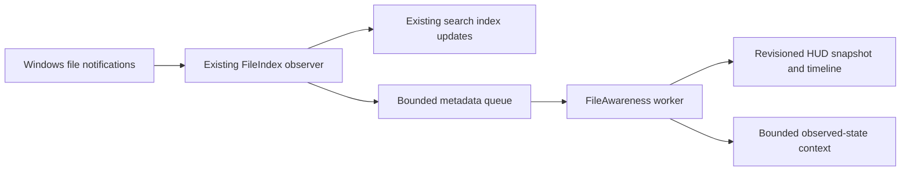

# Phase 6: shared file-change awareness

## Scope and authorization

The approved roadmap calls for event-driven file awareness and truthful HUD/core
state. The user requested broad coverage, starting with frequently used files and
folders. Reuse the existing index roots: Desktop, Downloads, Documents, OneDrive,
the project and fixed drives. User folders take priority over drive-root churn in
bounded buffers. This is metadata awareness, not a promise of complete file history
or permission to read private file contents.

The graph is older than the current workspace and includes historical backups.
Targeted current-source inspection was necessary to establish watcher contracts.
Existing working search and approved voice changes are preserved.

## Approach

Reuse FileIndex's watchdog observer and expose a metadata subscription. A second
recursive observer would duplicate subscriptions and work. Polling all drives
would add scans and latency. The chosen observer feeds a bounded awareness worker;
only recently observed paths are reconciled periodically.

Native callbacks copy validated metadata without file reads, stat calls or HUD
publication. The worker coalesces events, prioritizes personal folders, updates at
roughly 250 ms when active and reconciles recent metadata every 15 seconds. It
stores at most 256 pending and 64 recent observations. Model context includes at
most four roots, four failed roots and six changes; long paths are explicitly
labeled truncated display hints. HUD retains exact paths.

Payloads distinguish created, modified, moved, deleted and reconciled observations,
source/destination metadata, directory flags, timestamps and health. Reconciliation
does not invent a specific missed action. Data enters existing observed-state
context as data, not executable instructions or a task success claim.

## Reliability and coverage

- Own SQLite database and WAL/shm/journal writes are excluded before indexing;
  otherwise a notification can write the database and trigger another notification.
- Existing generated/system directory exclusions are reused. Era's project-local
  logs, memory and graph artifacts are excluded from awareness to avoid self-noise.
  The underlying existing index still performs its ordinary updates.
- Relative paths, outside-scope paths and resolved reparse escapes are rejected.
  Move destinations outside scope are redacted. No file content is opened.
- Native emitter health, failed/missing roots, unknown metadata, dropped events and
  stale snapshots are explicit. An overflow remains degraded; recent reconciliation
  cannot prove a complete history. Unchanged heartbeats do not add timeline items.
- The existing configured roots remain broad. Overlapping root subscriptions can
  produce repeated notifications; coalescing is counted. This does not install a
  second observer or force a rebuild of the user's index.
- Startup without configured index roots remains unavailable until ordinary index
  initialization runs. Known unavailable roots retry with backoff. Healthy observers
  are reused; late callbacks are rejected during index shutdown. Partial observer
  startup is also stopped before database closure.
- Service lifecycle belongs to the backend, independent of voice reconnects. A
  subscriber failure is isolated. Shutdown unsubscribes; worker failure/staleness
  removes affirmative evidence rather than reporting a false ready state.

No destructive steps, user-file mutation, new content reader, drive scan, device
change, live recording, Telegram message or live Era restart is included.

## Verification and transparent findings

Installed watchdog 6.0.0, already declared by project requirements. The first native
probe exposed its absence: the previous watcher silently disabled itself. Doctor
now checks this dependency. Pip's watchmedo PATH warning concerns its optional CLI;
Python library imports and the Windows observer work without a PATH change.

A disposable TEMP fixture demonstrated native create, rename and delete delivery,
correct exists/missing metadata, zero dropped events, one native emitter, matching
search-index deletion, clean subscriber stop and clean observer stop. Only the
verified disposable fixture was created/renamed/deleted; user folders were untouched.

Focused coverage checks queue overflow, personal-folder priority, path exclusions,
reconciliation, stale state, subscriber lifecycle, database feedback prevention,
existing search updates and HUD state ownership. An initial test assertion used a
nonexistent HUD snapshot key; corrected to the actual bus.state() contract. This
was a test error, not a demonstrated production failure. The final verification
counts and overall readiness results are recorded in PHASE6_PROGRESS.md.

## Remaining limitations and acceptance

Native proof in TEMP does not prove all-drive coverage, permission access or live
HUD behavior in the running Era process. Restart and real user-folder acceptance
remain pending. Coverage excludes skipped folders, removable/network drives outside
existing roots and inaccessible locations; event loss is possible under load.

The subsequent FILE_SUBTREE_REPAIR.md increment repairs known indexed descendants
and open-history paths on directory move/delete, including the native Windows
deleted-directory type issue and FTS update consistency. Newly unindexed trees
still depend on native child events or an ordinary rebuild; no recursive scan was
added to this metadata awareness service.
Device watchers, broader task recovery, physical audio acceptance and native
Telegram calling remain unfinished roadmap work.
