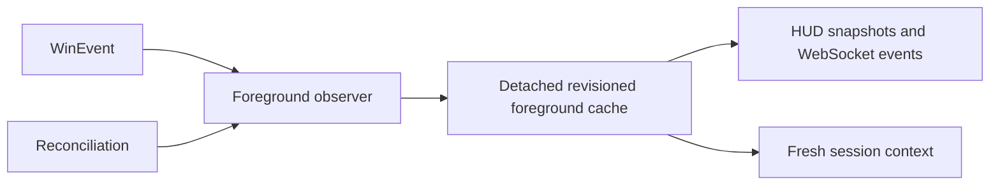

# Foreground observation ADR — 2026-10-13

Status: implementation authorized by the approved Phase 6 plan and user request
to proceed after warning repairs. The warning repairs passed before this increment.

## Decision

Add a read-only Windows foreground-event service, process-scoped like native media
observation. Reuse the existing installed win32/psutil dependencies and WinEvent
foreground hook. Read HWND, PID and process name only; exclude titles, paths,
window contents and input capture. Re-read current foreground after identity
resolution to reject races. Refresh every 15 seconds for reconciliation/freshness,
not high-frequency foreground polling. Do not reuse get_active_window(): it writes
intent memory as a side effect. Do not activate the dormant state_sync loop: it
polls continuously, collapses same-name processes and has a placeholder tab sampler.

Start once with the backend; voice reconnects cannot duplicate it. Hook and message
pump share their owning thread. Stop joins the worker and unhooks. Hook/read failure
clears foreground evidence and retries with bounded backoff. Expired snapshots
are unknown. Publisher failure must not invalidate valid native data. Only real
changes add HUD timeline items; older revisions are ignored after reconnect.

## Trade-offs and scope

A foreground hook is immediate and cheaper than continuous polling. A separate
WMI process inventory watcher would cover background launch/exit but adds lifecycle
and identity work beyond this increment. A native helper would isolate crashes but
adds another process; existing win32 dependencies allow a small in-process hook.
This is foreground app evidence only, not a running-process inventory or knowledge
of every open window. It does not mutate playback, windows, devices or standby.

## Verification

Fake source: changes, duplicate heartbeat, malformed/stale samples, detached
snapshots, publication failure, duplicate start and clean shutdown. Native read-only
hook registration/read/unhook probe; no window activation or input injection.
Existing window/process/media/HUD regressions, TypeScript and production HUD build.
Live manual Alt-Tab acceptance remains separate from native registration proof.
