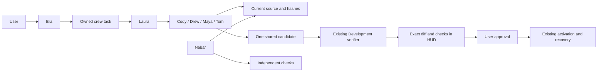

# Phase 8: coordinated project work

Date: 2026-10-15. Scope authorized by the approved Master Plan and the user's
instruction to proceed. CodeMode implementation remains a separate review gate.

Era owns the conversation and final approval. A crew root turn owns one cancellable
work record; Laura can delegate within that record. Hermes provides the selected
model transport, with remote tools still disabled. Capability execution stays in
Era, where grants, evidence, cancellation and approval are enforced.

## Implemented decisions

**One owner per crew task.** `crew/coordination.py` binds an inherited task token
or claims a new unique request. Nested handoffs retain root owner, original task,
work ID and participant membership. Only the scope that claimed the token releases
it. Repeated root requests return the running ID. Cancellation is checked before
and after model calls and before capability execution. A blocked remote model may
finish its current request; its returned command cannot start another capability.
Era's background crew worker now receives the existing cancellation token.

**Source access through capabilities.** Every configured role receives
`source.inspect` and `source.read`; all except Nabar receive `source.stage`.
Inspection uses local source discovery (now including `crew/`); reads provide current
SHA-256, line ranges and bounded, redacted contents. Traversal, linked paths, hidden
files, runtime/state/dependency trees and credential configuration are refused.
Supported project code and selected docs/crew configuration can be inspected.
Protected framework files are readable with `editable=false`; automatic promotion
continues to exclude them, credential/config files and unsupported file types.
This grants broad source understanding, not unrestricted machine access.

**One reviewed candidate, existing promotion path.** A team submits up to six
complete files and six focused tests, including a new or updated test. Each file
supplies the observed base hash (null only for a new file). The root task and
server-owned attribution become the development job; model-provided ownership is
ignored. The same submission is idempotent within that work record; another patch
in that record is refused. The existing global development slot serializes crew
and ordinary proposals. Submissions are checked for stale bases before queueing
and again before verification. Tests run in the existing separate source copy;
passing checks produce an exact diff and approval digest. Live activation still
requires the user's existing HUD approval and unchanged live/candidate hashes.
Ownership and contributors appear inside the existing Development drawer.

The source copy includes crew code and its role YAML/prompts. New coordination,
source-capability and submission guard files are protected from generated edits.
No second editor, deployment implementation or model-owned approval was added.

**Freshness and honest evidence.** Source content/hash data reaches the model
inside the existing untrusted observation fence. Source-derived answers are not
saved in the crew response cache; vault-only reads retain their cache. Tool listing
exposes per-role grants. Era's prompt and crew description explain staging and
pending verification; 58 public model tools remain, with crew capabilities nested
under the existing crew tool.

**CM ownership without a parallel dispatcher.** Identical active orders are
coalesced by brand/task/order. Every started request is HUD tracked and has its own
async cancellation context. The token is bound only inside its worker thread,
preventing concurrent async jobs from sharing thread-local cancellation. The existing
`era_dispatch` process/file lock still serializes CM execution across brands.
Cancellation suppresses later reporting/actions; external effects already sent
cannot be undone. CM still uses its established reporting and approval behavior.

## Alternatives and limits

Giving every role direct live filesystem writes would create competing edits and
bypass the existing review process. Separate long-lived clones per role would add
merge state without improving the current small-team request loop. The chosen
complete-candidate submission uses existing verification/recovery with minimal new
state. Role prompts and safety-critical files remain manually reviewed changes.

Work ownership is scoped to a crew turn. Development jobs persist separately;
an Era restart marks interrupted verification failed through existing recovery.
Cancellation of a crew conversation does not forcibly terminate a verification
process already submitted to Development. That process is bounded by the existing
600-second timeout and never automatically activates its files. The clone is not
an OS sandbox: tests run with the current user's permissions. No claim of sandboxing
or arbitrary-code isolation is made. Persistent cross-process distributed team
ownership, interactive per-role filesystem edits and forced remote-model abortion
are outside this increment.

Verification and remaining review are recorded in `PHASE8_PROGRESS.md`.
