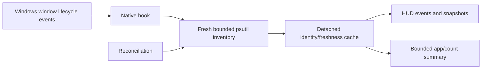

# Background process observation — 2026-10-13

Authorized continuation of Phase 6, after the warning/foreground increment passed
all 33 readiness gates. Preserve existing on-demand process tools.

## Decision and alternatives

The CIM probe was denied (CimException status 2) on this account. Use native
WinEvent window creation/destruction/show/hide as read-only change signals,
with no elevation or extra helper process. Coalesce hints at 0.5-second intervals;
non-window processes are covered by 15-second reconciliation, not instant native
process events. Reuse the foreground observer's native pump and worker lifecycle.
Reconcile signals against a fresh psutil inventory, retaining PID and creation
time per instance. Multiple processes with the same executable name must remain
distinct. Read only PID, name and creation time; no command lines, executable
paths, environment, window contents or credentials. Signals are hints, not proof
that the reported process is still running. Coalesce bursts and reconcile every
15 seconds. Cap snapshots and explicitly label omissions/unknown creation times.

Continuous 2-second polling costs repeated scans and misses short-lived changes.
ETW would add more native integration/privilege work. The attempted CIM approach
needed no new package but was denied. The selected WinEvent approach needs no
extra package/helper process. If hook registration fails, expose reconciliation-only
health instead of claiming native coverage or requesting elevated execution.

One process-scoped service owns its hook thread; shutdown unhooks and joins it.
Hook failure clears event coverage, retains fresh explicitly
degraded inventory, retries with bounded backoff and never changes app behavior.
HUD receives revisioned snapshots/events; reasoning gets a bounded name/count
summary, not hundreds of processes in every prompt. Existing task control still
queries live OS state before acting; PID reuse/unknown creation cannot authorize
terminating a process.

## Verification

Fake inventory: start/exit, same-name instances, PID reuse, inaccessible identity,
malformed or oversized data, staleness, detached values, helper degradation/retry,
duplicate startup, shutdown. Native read-only subscription and inventory probe;
no user apps opened or closed. HUD build/TypeScript, relevant awareness/tool
regressions, lint/compile and Doctor. Manual app lifecycle acceptance after restart
is separate from subscription registration proof. Foreground coalescing now shares
the native pump; regression checks preserve its initial read and clean shutdown.

References: Microsoft Win32_ProcessStartTrace and Register-CimIndicationEvent:
https://learn.microsoft.com/en-us/previous-versions/windows/desktop/krnlprov/win32-processstarttrace
https://learn.microsoft.com/en-us/powershell/module/cimcmdlets/register-cimindicationevent

Selected native hook contract:
https://learn.microsoft.com/en-us/windows/win32/api/winuser/nf-winuser-setwineventhook
