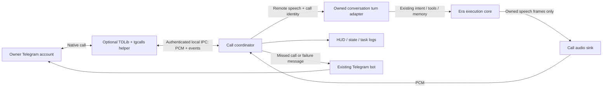

# Phase 5 — native Telegram call bridge

2026-10-13. Status: research completed; proposed architecture, not implemented.
The user authorized continuing Phase 5 and chose a separate Era account; they
do not have that account yet. No login,
native dependencies, device changes, messages, or calls were performed.

## Verified boundary

Telegram's [phone.requestCall](https://core.telegram.org/method/phone.requestCall)
is available to user accounts. The current Era Bot API token cannot provide
native one-to-one calls. Keep era_telegram.py for messages, voice notes, captions,
and approval buttons; native calling needs another authenticated transport.

Telegram describes [current call setup](https://core.telegram.org/api/calls),
with separate signaling and voice transport. Its documented
[TDLib createCall](https://core.telegram.org/tdlib/docs/classtd_1_1td__api_1_1create_call.html)
and [callStateReady](https://core.telegram.org/tdlib/docs/classtd_1_1td__api_1_1call_state_ready.html)
provide signaling state and connection/key information. These APIs alone do not
deliver usable PCM to Era. A compatible media implementation is also required.
The official [tgcalls](https://github.com/TelegramMessenger/tgcalls) source exposes
an audio-device-module factory in tgcalls/Instance.h. That is a candidate custom
PCM boundary, not proof that a working Windows integration is already available.

Application credentials come from Telegram's
[API development tools](https://core.telegram.org/api/obtaining_api_id).
They are separate from TELEGRAM_BOT_TOKEN. Authentication must be completed
locally by the user; never request OTPs, passwords, sessions, or API hashes in
chat or include them in logs.

## Decision ADR-005: isolated official client/media helper

Status: proposed architecture; separate-account choice confirmed, native build
spike and account creation pending.

Use the user's chosen dedicated Telegram account representing Era, with the owner's
existing personal account as the only allowed call peer. This creates the
separate caller/callee identities required by the desired “call Era back” UX.
Using the owner's account as Era's identity would not supply that separate
counterparty. This is a design inference, not a tested self-call API result.

Use an optional helper process for TDLib plus tgcalls, with a custom audio-device
module that exchanges PCM over authenticated local IPC. This isolates native
crashes, avoids coupling native bindings to Era's current Python 3.14 runtime,
and keeps physical device capture out of the call process. The helper's Windows
build and real duplex PCM behavior must pass a spike before this choice is
accepted. CMake/MSVC/Ninja were not found on this session's PATH; that does not
prove no Visual Studio installation exists. No native call dependency was found
in the inspected current Telegram code or dependency declarations.

Alternatives:

| Approach | Benefit | Cost / decision |
|---|---|---|
| TDLib + official tgcalls helper | Official signaling/media code; isolated from Python | Native/WebRTC build and custom PCM work; recommended spike |
| Third-party Python call wrapper | Potentially faster prototype | Must prove private-call capture and playback, Windows wheels, supported interpreter, maintenance, and licenses; not selected without those checks |
| Telegram Desktop plus virtual audio/UI automation | May demonstrate an existing client call | Fragile call control and device routing; risks glasses/PC regressions; rejected as production path |

At inspection, repository license metadata lists TDLib as BSL-1.0 and tgcalls
as LGPL-3.0. Verify exact pinned source and transitive WebRTC notices before
distribution. Repository licenses do not alone establish redistribution compliance.
Do not use deprecated libtgvoip examples or implement custom key exchange.

## Component flow

The helper owns Telegram authentication, call signaling, media transport, and
network reconnection. The coordinator owns peer authorization, lifecycle,
duplicate-call prevention, timeouts, and fallback decisions. A turn adapter owns
remote input provenance and reply destination. Existing tool risk classification,
shared pending confirmations, verification, task continuation, and memory remain
authoritative. Never construct another EraLive instance that opens hardware.

## Existing-code integration constraints

- app/era_live/audio.py::_send_realtime currently treats queued PCM as local
  microphone input and applies local mute, attention, speaker, and media gates.
  Injecting remote call frames into out_queue would mix those policies. Add a
  separately authenticated remote input boundary; local mic-off continues to
  control the local microphone. Call input has its own explicit mute control.
- core/input_envelope.py currently carries turn ID, source, text, and timestamp.
  Plan an optional immutable channel-session identity for a call generation.
  “telegram” alone cannot distinguish a live call from a text/voice-note reply.
- app/era_live/speech_out.py and native Gemini receive enqueue owned frames into
  audio_in_queue. Add an owner-aware sink before physical playback. Send only
  the call's frames to the helper; never mirror arbitrary local TTS into a call.
  Retain phrase/end markers, completion evidence, interruption, and engine failover.
- core/speech_frames.py already carries reply ownership and playback accounting.
  Remote playback needs its own accepted/rendered watermark, not a fabricated
  device write success. Do not count queue insertion as speech delivered.
- Shared live fields such as _last_user_text are not a second simultaneous
  conversation context. Serialize call commands through the existing command
  lane, or establish an isolated conversation context before dual-session support.
  A remote reply must never inherit the current local HUD turn's owner.

Initial duplex implementation: stream remote PCM into a separate utterance/STT
adapter, dispatch finalized commands through the same intent/tool/memory lane,
and stream owner-bound replies through the call sink. Preserve interruptions
without waiting for the full reply. Evaluate a dedicated native-live conversation
session only after ownership, dispatcher serialization, and tool safety tests.
This reduces initial blast radius but may add STT latency; measure it honestly.

Keep local speaker/media filtering unchanged. On call input, authenticated peer
identity proves the account, not who is speaking into the phone. If voice-lock
policy requires biometric verification, preserve that requirement and evaluate
the existing profile against telephone-compressed speech before enabling it.
Never silently weaken its threshold or auto-enroll unverified call audio. Test
phone-side music and remote echo explicitly; local PC playback detection is not
evidence of phone-side noise. The transport must never loop outbound TTS into
the incoming PCM path.

Negotiate the helper's actual PCM format. Resample into Era's existing 16 kHz
input and 24 kHz output boundaries using a stateful resampler. Do not assume the
transport's rate, treat per-packet resampling as sufficient, or reopen glasses
streams. Use bounded PCM buffers with sequence numbers and generation IDs. If
backpressure prevents intelligible output, stop and report degraded delivery
rather than replaying an uncertain sentence or building an unbounded backlog.

## Authentication and lifecycle

Store the optional session outside this OneDrive repository under the user's
local app-data directory, with Windows user-only access. Protect session/database
keys using an OS credential facility; native logs exclude key material and PCM.
Do not import the personal Telegram Desktop session. The call helper has no
reason to index chats, export contacts, or expose a general MTProto tool.

At setup, validate authenticated account identity differs from owner identity,
then bind the exact owner user ID. Incoming unknown peers are rejected before
media or tool dispatch. Keep one active call and a unique call generation. IPC
must authenticate the local user/process; localhost location is insufficient.

States: disabled → authentication required → ready → outgoing/incoming ringing
→ negotiating → active → ending → ended, with distinct failed/degraded states.
The HUD shows actual state, peer identity label, duration, call input mute, and
Hang up. Transport establishment and observed audio flow are required before
Era reports a connected voice conversation.

On inbound owner calls, accept according to the enabled call policy, wake the
control surface without reversing local microphone mute, and greet only after
media is ready. On hangup, stop capture, invalidate call-owned replies, clear
buffers, release resources once, and retain the task outcome. Old generation
events cannot revive an ended call or deliver PCM into its successor.

Outbound calling is opt-in. Only the configured owner may be called. Each
request has a job/event idempotency key; coalesce simultaneous notifications.
Proposed defaults: one ring attempt, 30-second answer timeout, 30-minute
proactive-call cooldown, and user-configured quiet hours. Explicit “call me”
requests may bypass the proactive cooldown, but not peer authorization or a
current call. Do not automatically redial after an ambiguous request response.
Privacy rejection, busy, no answer, and transport failure are distinct outcomes.

If unanswered, queue one clear fallback message through the existing bot with
the relevant task/result or approval request. A bot message is fallback messaging,
not a voicemail or native call. Use delivery acknowledgements and deduplication;
unknown sends remain unknown. No raw recording is saved by default.

## Incremental implementation and proof

1. Account/setup decision and offline native-build spike. Pin sources, verify
   licensing, compile on Windows, and prove custom bidirectional PCM with a
   fake transport. No session login or actual call required for this proof.
2. Authenticated local setup, owner-only signaling, state events, and Hang up.
   Verify authorization, duplicate events, auth revocation, busy/no-answer,
   exact-generation cleanup, helper crash, and protocol incompatibility.
3. Owned remote input and output sinks. Verify local mic privacy, channel
   isolation, resampling continuity, bounded queues, interruption, captions,
   failover, and no doubled speech. No new global Era audio default changes.
4. One explicitly coordinated live call in each direction. Confirm owner hears
   Era, Era hears normal and quiet remote speech, interrupt works, call ends
   cleanly, and local glasses routing stays correct. A signaling-only call does
   not pass duplex acceptance.
5. Opt-in proactive policies and unanswered fallback. Mock all outcomes first,
   then verify one scheduled event without repeated ringing/messages. Run the
   regression gate and report acoustic/calling acceptance separately.

No destructive source migration is proposed. New account authorization, native
build/dependencies, source/sink interfaces, and live acceptance are prerequisites;
the current bot bridge is retained throughout. Do not mark native calls complete
or Phase 5 accepted until these proofs and the deferred hearing tests pass.

## Current research outcome

Passed: current official API boundary, user-account requirement, TDLib signaling
surface, tgcalls media/custom-device candidate, and existing Era integration map.
Partial: native-helper recommendation; Windows build/custom PCM not yet proved.
Pending: creation of the chosen separate Era account, local authentication setup, native build,
transport implementation, and acoustic/live acceptance.

One guessed documentation URL /api/phone-calls returned a page-not-found response;
followed the official requestCall links to the correct /api/calls page. Initial
base64 source decoding split lines; decoded the complete payload before source
inspection. No unsupported API or dependency installation was substituted.
The optional agent-reach update check could not run because its CLI is not on
this shell's PATH; the skill's Jina/gh read routes were available and used.
A documentation amendment initially included a nonmatching context line; that
patch was rejected without changing files and retried against the actual text.

2026-10-13 resumed setup: user supplied separate Era/owner international numbers.
Pinned Windows native wheel imports and protected local account setup now pass.
See TELEGRAM_CALL_SETUP_PROGRESS.md for the revised third-party feasibility
evidence, local authentication window, verification and limits. Account login,
external PCM proof and both-direction live calls remain pending; calls stay disabled.
