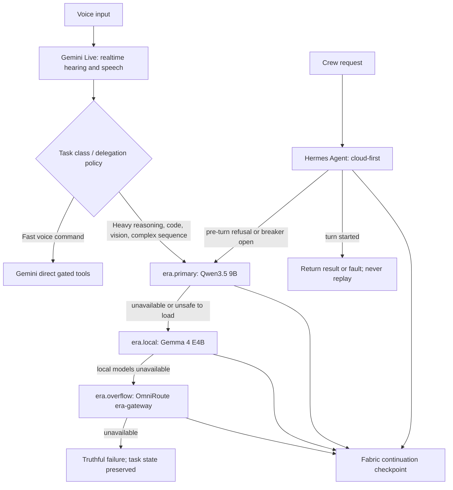

# Era Local-Primary Model and Smart Routing Design

Date: 2026-11-18
Status: Revised architecture approved; implementation authorized
Owner: Karim
Implementer: Codex

## 1. Outcome

Era keeps Gemini Live as its realtime voice interface while making a free local
Qwen3.5 9B model the primary engine for reasoning, coding, planning, vision,
structured output, and delegated tool work. Gemma 4 E4B remains the emergency
local fallback. The crew remains cloud-first through its verified Hermes Agent
transport and falls back to local Qwen only when Hermes refuses before the turn
or its health breaker is open. Direct Claude profiles are not used while they
are logged out.

Every model-backed task leaves a compact, structured continuation checkpoint in
the existing Fabric `TaskContext`. A later model receives this checkpoint and
artifact references instead of rereading the full conversation or repeating
completed work.

The implementation must preserve every existing protected behavior, especially
the Gemini Live audio/session rules and the single safety/confirmation gate used
for tool execution.

## 2. Audited baseline

Hardware and runtime:

- NVIDIA RTX 3070 Laptop GPU, 8 GiB VRAM; 5.58 GiB was free during the audit.
- Intel i7-12700H and 31.7 GiB system RAM.
- Ollama 0.40.16 runs from `D:\Ollama`.
- `OLLAMA_MODELS` already resolves to `D:\ollama models` at process and user scope.
- Ollama currently has no model resident.

Installed model inventory at design time:

| Tag | Size | Architecture / quantization | Current use |
|---|---:|---|---|
| `qwen2.5vl:3b` | 3.2 GB | Qwen2-VL 3.8B, Q4_K_M | Default Ollama vision model |
| `gemma4:e4b` | 9.6 GB | Gemma 4 8B/E4B, Q4_K_M | `era.local`; retained fallback |
| `qwen25-coder-64k:latest` | 4.7 GB | Qwen2.5 Coder 7.6B, Q4_K_M | No repository reference |
| `gemma4-64k:latest` | 9.6 GB | Gemma 4 custom context tag | No repository reference |
| `all-minilm:latest` | 45 MB | embedding model | Semantic memory; retained |
| `gemma4:latest` | 9.6 GB | Gemma 4 | File processor default |
| `qwen2.5-coder:7b` | 4.7 GB | Qwen2.5 Coder 7.6B, Q4_K_M | Local classifier / lane router |
| `kimi-k2.7-code:cloud` | remote | cloud tag | No repository reference |

Provider baseline:

- Both Claude profile directories exist, but both report `loggedIn: false` after
  the loopback gateway environment is removed. They are not valid direct
  subscription fallbacks.
- OmniRoute is listening on `127.0.0.1:20128`; a minimal Messages API probe
  succeeded through `gpt-5.6-sol` in 5.287 seconds.
- Hermes Agent is listening on `127.0.0.1:8642`; the `era_one` profile has six
  registered bots, no enabled tools, and completed a read-only Laura audit turn.
- No OpenRouter or AI Gateway credential is configured. This migration must not
  invent or require one.

## 3. Requirements

### Functional

1. Pull the official Ollama `qwen3.5:9b` tag whose language model component is
   Q4_K_M and install it in the existing D: model store.
2. Keep `era.voice` on Gemini Live.
3. Add a local primary alias for Qwen and retain Gemma as a distinct fallback.
4. Route heavy text, coding, planning, vision, and delegated tool work to Qwen.
5. Route lightweight local work to Gemma only as an emergency fallback, not as a
   concurrently resident model.
6. Keep the crew cloud-first on Hermes. Fall back to `era.primary` Qwen only when
   Hermes is rejected before work starts or its breaker is open, preserving every
   bot's capability grants and confirmation boundaries.
7. Use Gemma only if Qwen is unavailable. Use OmniRoute only for a configured
   provider-neutral overflow path that is safe to start; never replay a partial
   crew turn through it.
8. Never route automatically to the logged-out direct Claude profiles.
9. Persist a bounded continuation checkpoint after success, failure, timeout,
   confirmation pause, and provider handoff so another model resumes from the
   last proven state.
10. Remove obsolete Ollama tags only after their consumers are migrated and all
   verification passes.

### Non-functional

- Only one generative model may be resident in VRAM at a time.
- All Ollama text paths use the same 12,288-token context to prevent reloads.
- A model/provider failure must be visible in logs and provenance.
- A failover must not replay a tool or side effect that may already have run.
- No secret value may be logged, committed, or printed by diagnostics.
- Startup and ordinary voice latency must not regress because of the migration.
- Local work is admitted only when configured temperature and available-memory
  limits are safe; an unsafe local load fails over or returns a truthful pause.
- Checkpoints are size-bounded, redact secrets, reference artifacts rather than
  copying them, and never treat model-written prose as proof of a side effect.
- Deletion must use explicit `ollama rm <tag>` targets and remain recoverable by
  pulling the recorded tags again.

## 4. Architecture



### Alias contract

- `era.voice`: unchanged Gemini Live realtime alias.
- `era.primary`: Ollama `qwen3.5:9b`, with tools, JSON schema, streaming, vision,
  and local zero-cost reporting.
- `era.local`: Ollama `gemma4:e4b`, the emergency local fallback.
- `era.classify`: migrates to `qwen3.5:9b` so the removed Qwen2.5 model cannot
  force a third resident-model swap.
- `era.overflow`: direct OmniRoute adapter using the existing loopback
  `era-gateway` combo.
- `era.reason`, `era.deep`, and `era.cheap`: marked unavailable while the direct
  Claude profiles are logged out. Their historical measurements remain in the
  file for later restoration.

The registry remains the single source of truth. Call sites use aliases, never
new hard-coded provider model names.

### Voice boundary

Gemini remains the only realtime audio model. Fast spoken actions keep their
current path. Heavy spoken work is delegated through one bounded local-agent
tool. That tool runs Qwen's existing `LocalBrain` loop and returns the final
answer to Gemini for speech. The delegated brain receives the normal Era tool
surface except the delegation tool itself, preventing recursion. Every nested
tool call goes through the same dispatcher, confirmation store, grounding rules,
and completion evidence as a direct Gemini tool call.

Typed/HUD/Telegram heavy questions use the provider-neutral dispatch path.
Action-shaped requests stay on the gated tool path rather than being converted
into an ungated prose answer.

### Crew boundary

The default crew transport remains the existing `hermes_agent` transport, which
is already live-verified. The existing Fabric F1 boundary remains authoritative:

- Hermes healthy: the cloud crew owns the complete turn.
- Hermes breaker open, or gateway refusal before the turn starts: the same
  `BotSpec` runs in-process on `era.primary` Qwen.
- Qwen unavailable or unsafe to load: Gemma may answer with the same grants.
- A Hermes/model failure after a turn starts is returned and checkpointed. The
  task is not automatically replayed through another provider because a tool may
  already have run.

The local in-process fallback becomes provider-neutral but keeps every existing
capability, safety, confirmation, and cancellation boundary. OmniRoute remains a
separate overflow alias for new work that is safe to start, not an automatic
replay target for a partially completed crew turn.

### Continuation checkpoint contract

The existing append-only `core.fabric.context` log is extended with a `checkpoint`
record rather than adding a second memory database. Each record contains only:

- `ctx_id`, task status, timestamp, and monotonically increasing sequence;
- provider/model/alias and normalized failover reason;
- completed step summaries and observation/artifact references;
- decisions already made, pending confirmation id/status, and the next action;
- a short bounded model handoff note, treated as untrusted context rather than
  evidence.

The runtime writes a checkpoint after every completed model step and on every
terminal or paused outcome. It clips text, removes credential-shaped values, and
stores references instead of source payloads. `TaskContext.for_turn()` includes
only the latest checkpoint, so a successor starts at the last proven state. Tool
results and completion-verifier records remain the evidence; a model cannot mark
its own side effect complete merely by saying so in the handoff note.

## 5. Ollama performance and lifecycle policy

Persistent Windows user environment:

```text
OLLAMA_MODELS=D:\ollama models
OLLAMA_NUM_PARALLEL=1
OLLAMA_MAX_LOADED_MODELS=1
OLLAMA_FLASH_ATTENTION=1
OLLAMA_KV_CACHE_TYPE=q8_0
OLLAMA_KEEP_ALIVE=5m
ERA_CREW_TRANSPORT=hermes_agent
ERA_LOCAL_MAX_GPU_TEMP_C=82
ERA_LOCAL_MIN_AVAILABLE_RAM_GB=4
```

Rationale:

- One parallel request and one loaded model prevent Qwen and Gemma colliding in
  8 GiB VRAM. Requests queue instead of multiplying KV caches.
- Flash Attention lowers attention memory and improves throughput when supported.
- Q8 KV cache is the quality/memory compromise; Q4 is not used initially because
  tool/JSON reliability matters more than a small additional saving.
- The shared `SHARED_NUM_CTX=12288` remains unchanged. The advertised 256K native
  context is not an operational target on this GPU.
- The Ollama adapter stops hard-coding `keep_alive: 30m` and honors the user
  environment. Five minutes amortizes nearby turns while returning VRAM promptly
  to desktop, media, and Gemini Live workloads.
- GPU layer placement remains automatic. The Windows desktop already consumes a
  variable portion of VRAM, so a fixed `num_gpu` could either underuse the GPU or
  cause an out-of-memory failure. Verification records the observed CPU/GPU split.
- Thinking is off for fast/simple work and enabled only for medium/high effort
  Qwen requests. The request's effort hint, not a model-global setting, decides.
- Before a cold local load, a lightweight admission check refuses to start when
  GPU temperature is at or above 82 C or available system RAM is below 4 GiB.
  A missing telemetry source does not invent safety: it records `unknown` and
  relies on Ollama's one-model/one-request memory limits.

Ollama is cleanly restarted after user environment changes so its server process
inherits them. The pull is then performed with `ollama pull qwen3.5:9b` and
verified with `ollama show qwen3.5:9b` before any Era config points at it.

## 6. Failover and health rules

Advance to the next candidate on normalized model failures:

- timeout;
- transport/unavailable;
- rate limit or exhausted quota;
- authentication/billing rejection;
- model not installed / unsupported;
- empty, malformed JSON, or schema-invalid output.

Do not fail over on:

- a valid refusal or ordinary answer;
- confirmation-required, denied, cancelled, or review-paused results;
- any ambiguous condition after a side effect may already have started.

Existing Era Fabric health breakers are reused. A repeatedly failing candidate is
skipped during its breaker window, avoiding repeated timeout latency. Every result
records the chosen alias/provider/model plus `fell_back_from` and the normalized
reason. If all candidates fail, Era gives one truthful error and retains pending
task/confirmation state. The latest checkpoint is written before control changes
provider or returns to the caller.

OmniRoute is represented as its own provider/alias. This removes the misleading
state where a `claude_cli` alias appears healthy because OmniRoute answered before
the logged-out CLI was tried.

## 7. Code/config surfaces

Expected implementation surfaces, subject to protected-fix checks before edits:

- `config/llm.yaml`: aliases, routing chains, provider state, and task mapping.
- `core/llm/registry.py`: provider/alias runtime metadata if required.
- `core/llm/router.py`: ordered chain policy without replacing the existing pure
  route decision contract.
- `core/llm/adapters/ollama_chat.py`: environment-aware keep-alive, effort-based
  thinking, accurate capabilities, and existing image/tool support.
- `core/llm/adapters/omniroute.py`: direct provider registration/health semantics.
- `core/llm/resource_guard.py`: cold-load admission using bounded GPU-temperature
  and available-RAM thresholds, with no persistent polling loop.
- `app/era_live/dispatch.py`: provider-neutral dispatch and action-shaped guard.
- `core/local_brain.py` plus the existing tool declaration/dispatch surfaces:
  bounded local delegation with no recursive delegation tool.
- `crew/fallback.py`, `crew/runtime.py`: Hermes-first fallback to provider-neutral
  local Qwen without replaying a started turn.
- `core/fabric/context.py`: bounded latest-checkpoint persistence and rendering.
- `core/vision_config.py`, `core/empower_config.py`, `actions/file_processor.py`,
  `lane_router.py`: migrate obsolete model defaults to Qwen/registry aliases.
- focused tests and the protected-fix registry.

Unrelated PF-041/042 changes in the dirty worktree must be preserved.

## 8. Verification plan

### Model/runtime

1. `ollama show qwen3.5:9b` proves 8.95B Q4_K_M plus vision capability.
2. Run read-only probes for plain text, strict JSON, native tool selection,
   multi-step tool continuation, and one local image.
3. Record cold load, warm generation speed, peak VRAM, and CPU/GPU split.
4. `ollama ps` must never show more than one loaded generative model.
5. Record GPU temperature and available RAM before/after probes; verify unsafe
   mocked admission refuses a cold local load without affecting Gemini Live.
6. After the five-minute keep-alive window, verify the idle model unloads.

### Routing/failure

- Unit tests pin heavy local work to Qwen and Gemma as its emergency fallback.
- Mocked timeout, rate-limit, auth, unsupported, empty, and malformed-output
  failures prove ordered fallback.
- Tests prove a valid refusal does not fall through.
- Tests prove no capability/tool is replayed across a fallback.
- Tests prove `era.voice` remains Gemini Live and retains realtime-audio capability.
- Tests prove direct Claude aliases cannot be automatically selected while logged out.
- Tests prove every terminal/pause/failover outcome writes one bounded checkpoint,
  and the next model receives the latest checkpoint without full-history replay.

### Crew and live path

- Run registry, router, quota-failover, local-fallback, dispatch, crew registry,
  crew loop, review, and Hermes compatibility suites.
- Run one read-only request while Hermes is healthy and inspect cloud provenance.
- Simulate a Hermes preflight failure and prove the in-process fallback uses Qwen.
- Simulate a post-start Hermes fault and prove no local replay occurs.
- Live-check one simple spoken command remains on Gemini.
- Live-check one heavy spoken request delegates to Qwen and Gemini speaks the
  result without executing any unconfirmed action.

### Project gate

- Add PF-043 with guards that fail if the voice alias changes, Qwen ceases to be
  primary, Hermes ceases to be crew-first, checkpoints disappear, the fallback
  order changes silently, or two local models may be kept resident by Era's
  configuration.
- Run `python tools/protected_fixes.py check`.
- Run `python tools/era_gate.py --changed <all changed files>` on Windows.
- Update `handoff.md` and `TODO.md` with measured proof and remaining live checks.

## 9. Cleanup and recovery

Cleanup happens only after the new primary and all guards pass. Before removal,
run a final repository reference search and `ollama list`. Keep:

- `qwen3.5:9b`;
- `gemma4:e4b`;
- `all-minilm:latest`.

Remove, when no consumer remains:

- `qwen2.5vl:3b`;
- `qwen25-coder-64k:latest`;
- `gemma4-64k:latest`;
- `gemma4:latest`;
- `qwen2.5-coder:7b`;
- `kimi-k2.7-code:cloud` (manifest cleanup; no local weight saving expected).

Use explicit `ollama rm <tag>` commands, never filesystem deletion. Ollama may
deduplicate blobs, so report actual store size before and after instead of adding
the displayed tag sizes. Recovery is `ollama pull <recorded-tag>`.

If Qwen fails acceptance, restore the previous routing configuration, keep
`gemma4:e4b` as `era.local`, restore the old referenced tags if removed, and leave
the downloaded Qwen tag installed until the failure is understood. No cleanup is
performed on a failed migration.

## 10. Architecture decisions

### ADR-001: Preserve Gemini Live as the voice transport

**Decision:** Gemini Live remains `era.voice`; local models handle delegated
intelligence rather than raw realtime audio.

**Alternatives:** Fully local Whisper/Qwen/TTS as the default; replacing the
entire voice stack.

**Consequences:** Voice stays low-latency and protected session behavior remains
stable. Era still uses a cloud voice path when it is available, but existing
local fallback preserves operation during outages.

### ADR-002: Extend the alias/provider architecture

**Decision:** Add local-primary and overflow aliases and make existing dispatch
and crew call sites provider-neutral.

**Alternatives:** Config-only alias replacement; a new standalone router.

**Consequences:** More implementation than a YAML edit, but one observable
routing contract serves Era and the crew without parallel policy engines.

### ADR-003: One loaded model and automatic GPU offload

**Decision:** Serialize local inference, load one model, share a 12,288-token
context, and let Ollama choose the safe layer split.

**Alternatives:** Keep Qwen and Gemma resident; force all Qwen layers onto GPU;
use CPU-only inference.

**Consequences:** Model switches have a cold-load cost, but the system avoids
VRAM exhaustion and remains responsive for desktop/media workloads.

### ADR-004: Cloud-first crew, local-primary Era

**Decision:** Era's own heavy intelligence starts on Qwen. Crew work starts on
Hermes/cloud when healthy, then falls back only on a pre-turn refusal or open
breaker to Qwen, then Gemma. OmniRoute is a separate overflow for safe new work.

**Alternatives:** Local-first crew; direct Claude fallback; automatic replay of a
started cloud turn.

**Consequences:** Cloud quality and capacity are used first for the crew without
occupying VRAM. Era remains usable without paid providers, and a partial turn is
never duplicated across providers.

### ADR-005: Structured continuation checkpoints

**Decision:** Extend Fabric `TaskContext` with a small latest-checkpoint record
after every model-backed step and pause/terminal outcome.

**Alternatives:** Replay full chat history; rely on voluntary model summaries;
create a separate handoff database.

**Consequences:** A successor model resumes cheaply from proven state and
artifact references. The handoff note improves continuity but remains untrusted;
runtime evidence still decides what actually happened.
